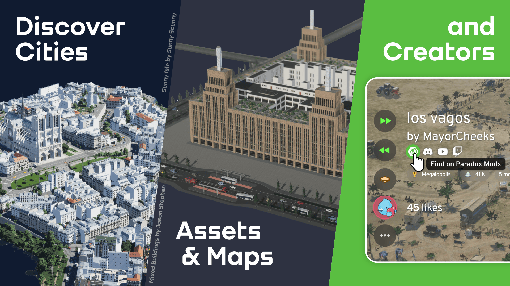
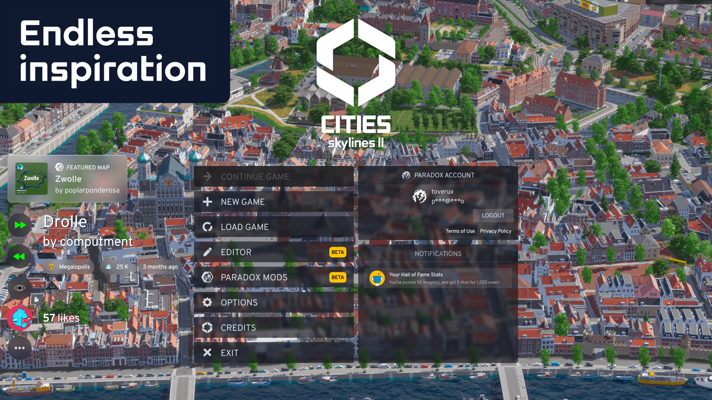
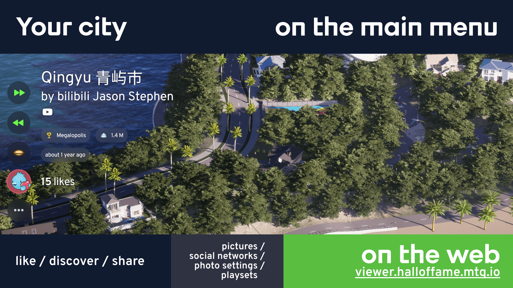
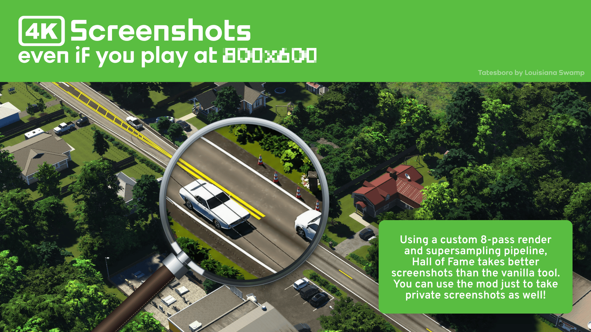
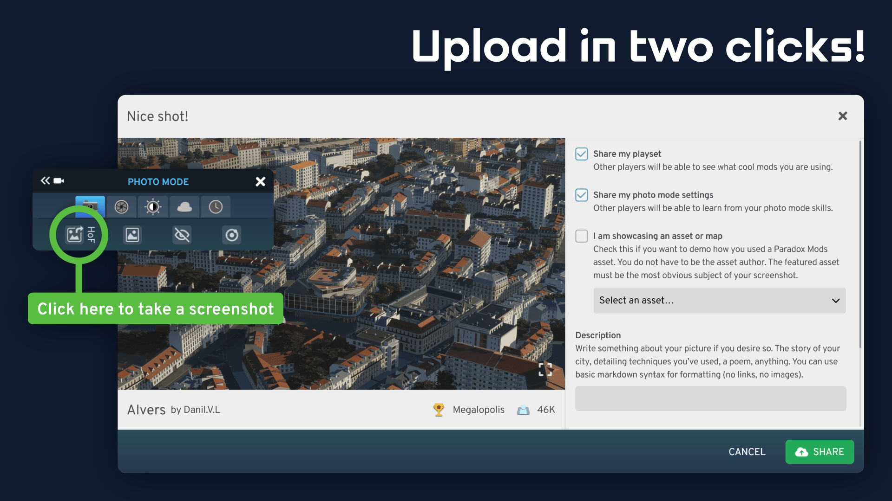
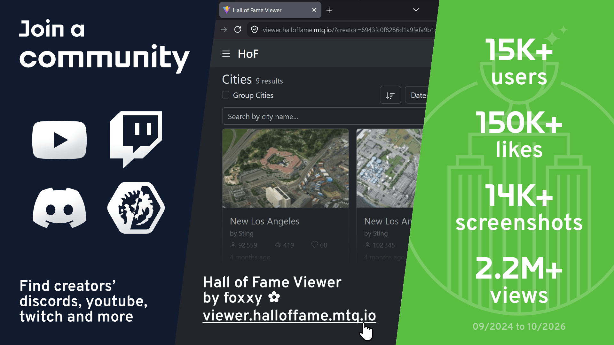

# Hall of Fame for Cities: Skylines II

A Cities: Skylines II mod that allows players to take and upload screenshots of their city and share
them with the community.

Screenshots are uploaded to a server and can be viewed by other players as a background image in the
main menu, with information about the creator, the city name and controls to refresh the image,
upvote or hide the UI to better see the image, to name a few features.

**As of April 2026, Hall of Fame has registered:**

- 👥 **13K** users tried the mod
- ❤️ **120K** likes were given
- ⬆️ **12K** screenshots were uploaded
- 👀 **1.7M** image views

See also: **[📈 live community statistics](https://metabase.mtq.io/public/dashboard/a74fc50f-8e69-43b7-bdba-7e5fc7420c1b?date_range=thisyear)**

---

<h3 align="center">
  
  &nbsp;
  <a href="https://mods.paradoxplaza.com/mods/90641/Windows">
    Find the mod on Paradox Mods
  </a>
</h3>

<h4 align="center">
The source code for the server is at
<a href="https://github.com/toverux/HallOfFameServer">toverux/HallOfFameServer</a>
</h4>

---

<table>
<tr>
  <td>
    
  </td>
  <td>
    
  </td>
  <td>
    
  </td>
</tr>
<tr>
  <td>
    
  </td>
  <td>
    
  </td>
  <td>
    
  </td>
</tr>
</table>

## Features & Roadmap

**Notable features:**

- Supersampling all screenshots you make to **4K** resolution even if you play at a lower
  resolution, and makes better renders than the game’s native screenshot tool.
- Have pictures displayed in the main menu, with various information about the city, author, etc.
- Give a like to the pictures you appreciate and see popular pictures.
- Toggle menu UI visibility to admire the pictures (like a slideshow).
- Fine-tune how the algorithm chooses screenshots that are presented to you (recent screenshots,
  trending, ancient and forgotten, etc.).
- Make screenshots and upload them via a dedicated interface, all in-game.
- Choose between Full HD and 4K resolution for pictures shown in the main menu.

**Roadmap:** see our feedback & feature requests board here:
[feedback.halloffame.cs2.mtq.io](https://feedback.halloffame.cs2.mtq.io)

## Acknowledgements

The mod is directly inspired from the homonymous mod for Factorio,
[Hall of Fame](https://mods.factorio.com/mod/HallOfFame).
[Loading Screen Mod Revisited](https://steamcommunity.com/sharedfiles/filedetails/?id=2858591409)
for Cities: Skylines 1 also provided a similar feature. 
Both mods featured hand-picked screenshots, whereas this mod allows everyone to share their
creations.

Special thanks to:

- The Cities: Skylines Modding Discord community in general for their help and kind support.
- **[Chamëleon TBN](https://linktr.ee/chameleon_tbn)** for providing some icons the mod uses and algernon for the
  [Unified Icon Library](https://github.com/algernon-A/UnifiedIconLibrary).
- **CloverPie, Danil.V.L, Hendrix, Jojodaisuke, Konsi, Prophedt, TheBusStop, ThemisC2, Tigon
  Ologdring**, for having tested the mod and uploaded the first content, so we have beautiful images
  on launch.
- **ThemisC2** for his hum, relentless support to help me finally finish a personal project.

## Development

This mod started from [Greenfield Mod Template](https://github.com/CitiesSkylinesModding/greenfield-mod-template), whose README explains its tooling and the reasons behind it.

### Setup

- [mise](https://mise.jdx.dev), then `mise install` for the pinned bun and .NET SDK.
- The game's modding toolchain, installed from the game's Modding options. On Linux, where that installer cannot run, `mise setup:linux` installs it.
- `bun install`, then `bunx lefthook install` for the git hooks.

### Commands

- `mise build`: Builds the mod and deploys it to the game, which must be closed.
- `mise build:ui`: Builds and deploys the UI alone, with the game open.
- `mise dev`: Rebuilds the UI on every change.
- `mise check`: Type-checks the UI, lints it, and checks its formatting.
- `mise fix`: Applies the lint fixes, then formats the TypeScript and the C#.
- `mise test`: Runs the off-engine C# tests, the UI tests, and the scripts' tests.
- `mise l10n:pull`, `mise l10n:push`: Pull translations from Crowdin and push the repo's edits to it.
- `mise publish`: Publishes a new version on Paradox Mods.

Run `mise tasks` for the full list.

An agent restarts the game with the `cs2-modding` plugin's `cs2-dev` tools.
